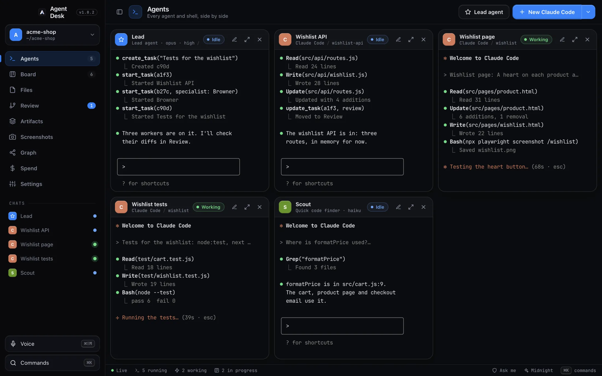
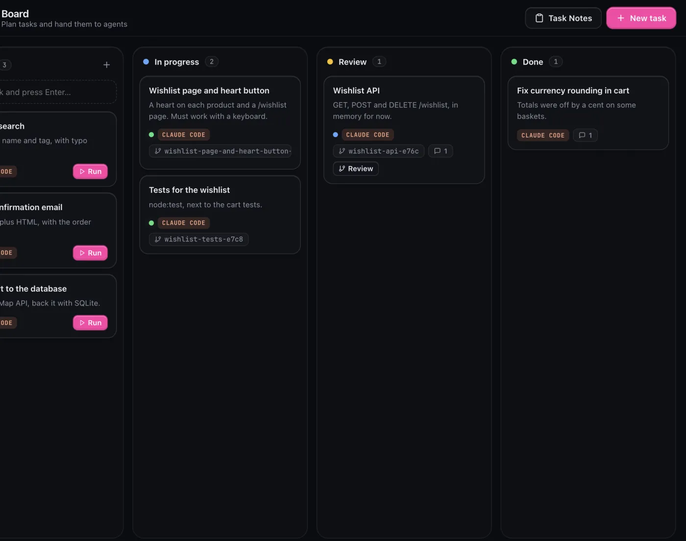
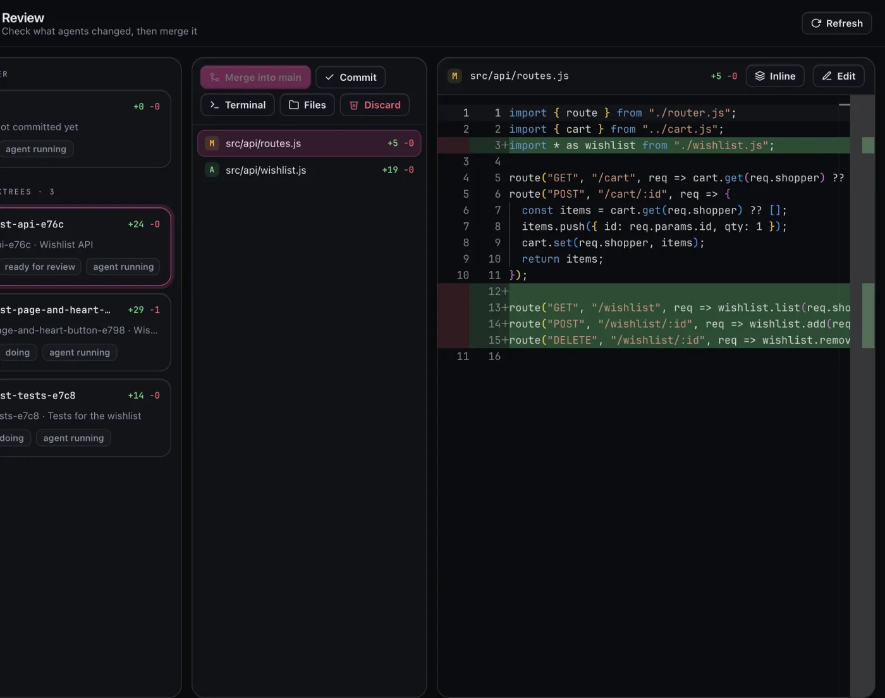
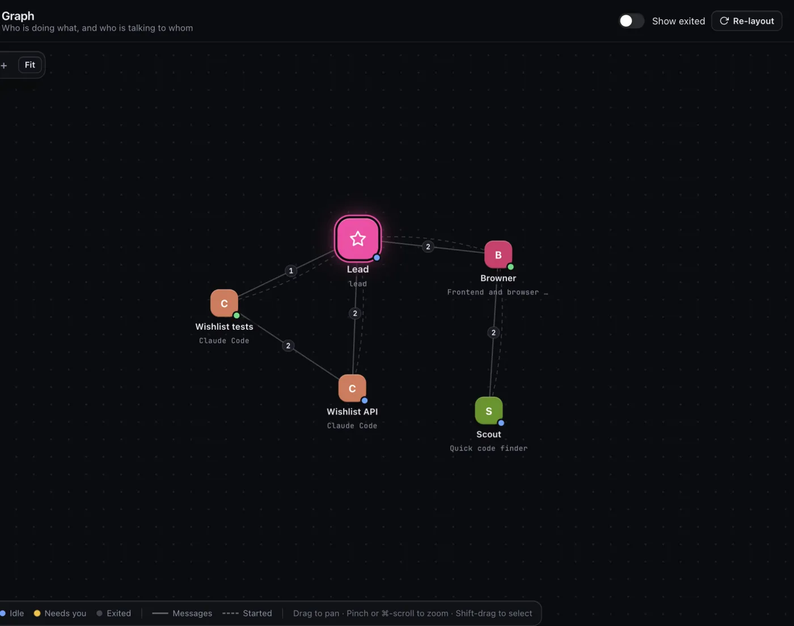
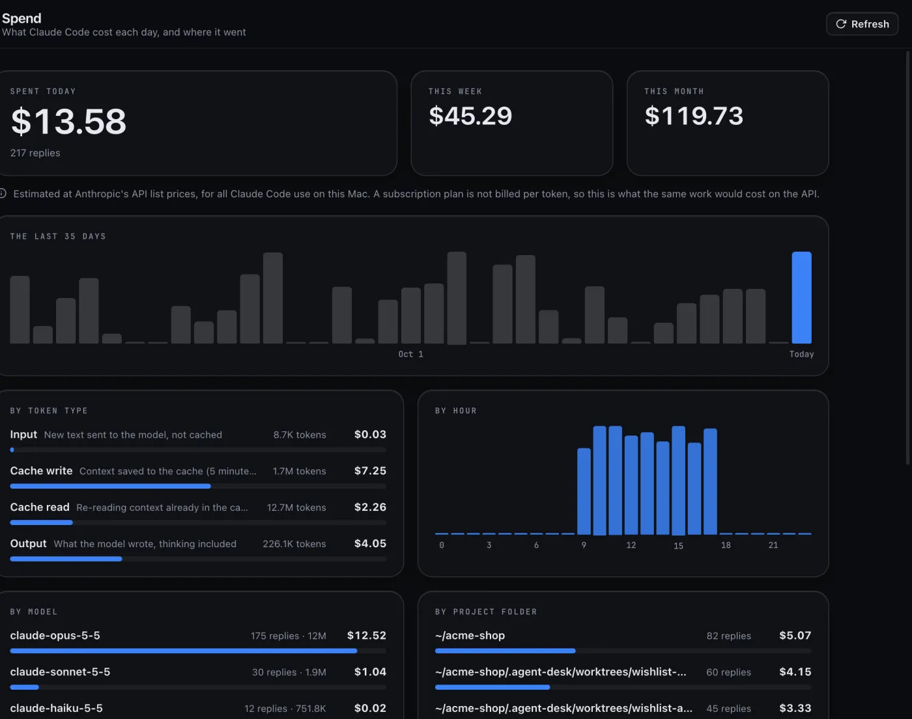

# Agent Desk

A Mac app for running a team of coding agents side by side, like BridgeMind's BridgeSpace. Every pane is a
real terminal running the agent's own CLI, so Claude Code uses your normal Claude login and subscription.

## Use it

    npm install
    npm start            # browser version: open the link it prints
    npm run app          # Mac app, from source
    npm run dist         # builds dist/Agent Desk-<version>-<arch>.dmg
    npm run check        # self-check of the server, security and MCP

The DMG is signed ad-hoc (there's no Apple developer account), so the first time you open the copied app,
right-click it and choose Open (macOS 15+: System Settings → Privacy & Security → Open Anyway).

### Verifying a download

Each release lists its DMG's SHA-256 in the notes. From v1.9.0, GitHub Actions builds the DMG and adds a `.sha256` file and a signed build-provenance attestation.
Run these in the folder with the download (`<name>` is the DMG's file name):

    shasum -a 256 -c <name>.dmg.sha256
    gh attestation verify <name>.dmg -R aahannp/agent-desk

## What's in it

- **Agents**: up to 16 Claude Code, Codex, Gemini CLI, Cursor Agent or shell panes in a grid. Each one shows
  whether it's working, idle, needs you, or finished, and you get a notification when an agent needs you.
- **Agents talk to each other**: tell an agent to ask Christie something, and the message is typed into
  Christie's pane, signed with who sent it, where you can watch the exchange. She answers the same way. If no
  Christie is running in the project, a new one starts. Each agent asks you before its first message. Messages
  are plain text only (no control keys), are never typed into a pane waiting at a permission prompt or into a
  shell, stay within the project, are capped at 20 per project per 10 minutes, and Settings can turn them off.
- **Agents work together**: name any agent (the pencil on its pane, or rename its chat) and others reach it by
  that name: "Emilie, work with Adam on this". Every agent knows who started it and who else is on the board, can
  read another's conversation to catch up (`read_agent_chat`), and can copy itself or another agent with its
  whole conversation to take on another part (`clone_agent`). Settings decides whether they do this without
  asking you each time; their edits and commands still ask.
- **Model and effort**: defaults for Claude Code agents, lead agents and each specialist (Christie on Sonnet,
  Browner on Opus, Scout on Haiku). Ask for "a lighter model" or "more effort" and the agent goes one step from
  its default.
- **Lead agent**: give it a goal and it plans tasks on the board, then starts a worker for each one in its
  own git worktree.
- **Lead upkeep** (Settings, off by default): when a lead is idle at its prompt with its context at 70% of a
  200K-token window (or of a smaller one: its model's, or your Claude Code auto-compact window), Agent Desk types
  `/compact` into it. After 3 compactions a fresh lead with the same name takes over, handed
  its summary, open tasks, running workers and last messages; the old chat stays in the sidebar.
- **Team**: named specialists, each a Claude agent with one area of expertise, its own instructions and,
  if you like, a model (Opus, Sonnet or Haiku). Christie is a learning coach who teaches you anything step by
  step, Browner a frontend expert, and Scout a quick code finder on Haiku. Add your own in Settings, and start
  one from the New Claude Code menu. Every agent knows who is on the team and what each running agent was
  asked, and can start a specialist on a model it picks for part of its job (turn that off in Settings).
  Agents can read each specialist's full profile, and when you ask ("Scout, make your answers shorter") change
  one, their own included, after asking you; agents started after that get the change (turn that off in Settings too).
- **Board**: To do / In progress / Review / Done with drag and drop. Run hands a task to an agent. Agents post
  comments and move their own cards through the board's MCP tools.
   
- **Review**: side-by-side diffs of each worktree against where it branched, then commit, merge, or discard.
  When an agent edits files in another repo or a worktree it made itself, that repo joins your projects and its
  Review lists the worktree, with who made it.
   
- **Graph**: every agent and shell as a node (the lead ringed in the middle), lines for who messaged whom with
  a count (dashed for who started whom), and the newest messages glowing along them. Click a node to see its
  screen (a live mini terminal) and conversation and ask it something; drag or use two fingers to pan, pinch or ⌘-scroll to zoom; shift-click or drag a box to select nodes and make a named group.
   
- **Spend**: what Claude Code cost each day, priced at API list prices from its own transcripts. Shows the
  last 35 days, and breaks a day down by token type, model, project folder, session and hour. Finished days are
  saved (`usageDays` in `desk.json`), so they stay after Claude Code deletes old transcripts.
   
- **Files**: a file tree and the Monaco editor (VS Code's editor), for the project or any agent's worktree.
- **Browser panes** for your dev server, **command blocks** in shells (each command and its output as a
  block), **screenshots** you can mark up and hand to an agent, **voice input** (on-device in the Mac app),
  **16 themes** (6 light), a **command palette** (⌘K), **⌘1–9** to jump between views and an animated cursor. Claude Code panes use the theme's own colours
  for their prompt bar, text and selection (kept readable), through a Claude Code theme Agent Desk keeps at
  `~/.claude/themes/agent-desk.json`. Switching themes, light or dark, repaints open panes too.
- **Artifacts**: pages, reports and charts your agents make (they save them with the `save_artifact` tool). Sort them into folders by dragging a page onto one or using its right-click menu, and agents can file a page in a folder as they save it.
  View them in the app or your browser, and publish one to GitHub Pages with one click, using an account
  you're signed in to with `gh`. Agent Desk keeps them in one repo it makes, and never writes to any other.
  Unpublish takes a page down again.
- **Task Notes**: the Board's Task Notes button lists your open tasks from the Task Notes app. Add one to hand
  it to an agent, and Task Notes follows its card (In progress and Review show as in progress, Done marks it
  done). Only tasks you brought over are written back, and only their status.
- **Updates**: the version pill next to the logo checks this repo's GitHub releases. When a newer one is out it
  says Update, and one click downloads the new .dmg into your Downloads folder.
- **MCP for your own Claude Code**: Settings shows a one-line `claude mcp add` that gives the same 18 board
  tools to Claude Code anywhere.

## Safety

- The server only listens on 127.0.0.1. Every request needs this install's secret (kept in a file only you
  can read) and must come from Agent Desk's own page, so other websites and other users on the Mac can't
  use it.
- Each agent gets its own token, which only reaches its board tools and hooks and always acts as that agent;
  the master secret never goes in its config. An agent with shell access runs as you, though, so it could
  still read the secret file in the data folder: real isolation would need a separate macOS user.
- Browsers don't separate cookies by port, so in the browser version (`npm start`) Agent Desk's login cookie
  also goes to any other localhost server you open in that browser. The Mac app keeps it to Agent Desk only;
  in a browser, use a profile just for Agent Desk.
- Claude agents start in "Ask me" permission mode by default, and nothing here offers the bypass modes.
- A lead agent can't type into other agents or stop them without your approval.
- Agents only see, read, stop and diff agents in their own project, and can't read or stop your shell panes.
- Merging asks you first, and it stops cleanly on conflicts.
- The Mac app turns off Electron's run-as-Node and inspector switches, uses the hardened runtime, and only
  lets its own page capture the screen.

## Data

The board, settings and the secret live in `data/` (browser version) or `~/Library/Application Support/Agent Desk`
(Mac app). Spend history is in the same `desk.json`. For Claude Code panes it also writes one theme file,
`~/.claude/themes/agent-desk.json`, and reads (never changes) Claude Code's transcripts for Spend. Agent worktrees and screenshots go in `.agent-desk/` inside each project, which is kept out of git.

## License

MIT. See [LICENSE](LICENSE).
